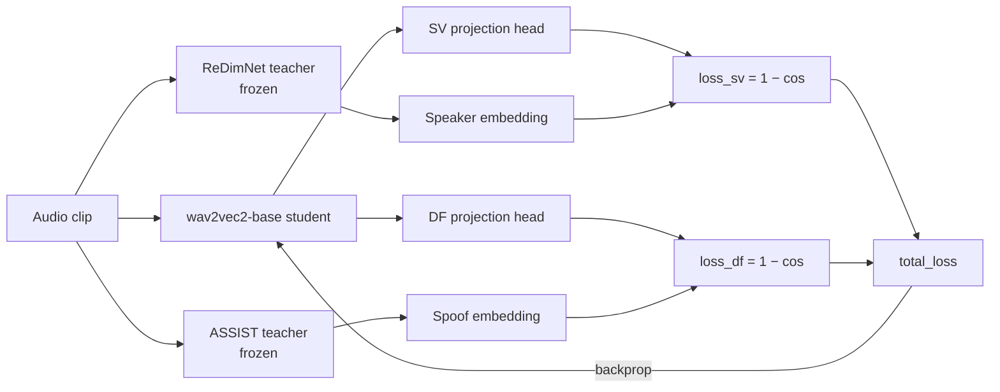

<div align="center">


<sub>Distillation loss curves — total loss 1.56 → 0.0053</sub>

# 🎙️ Dual-Teacher Distillation with Wav2Vec2

### One wav2vec2 student, two frozen teachers — speaker verification and deepfake detection in a single model

   

[](LICENSE)    

[](https://codespaces.new/shiroonigami23-ui/11-785-dual-teacher-distillation?quickstart=1) [](https://github.com/shiroonigami23-ui/11-785-dual-teacher-distillation/archive/refs/heads/main.zip)

[**Overview**](#-overview) · [**Features**](#-features) · [**Architecture**](#-architecture) · [**Getting Started**](#-getting-started) · [**Roadmap**](#-roadmap)

</div>

---

## 📖 Overview

Production voice-security stacks usually run **two separate models**: one for **speaker verification (SV)** and one for
**spoof / deepfake detection (DF)**. This project, built for CMU **11-785 Introduction to Deep Learning**, asks whether a
*single* `wav2vec2-base` student can learn both skills at once by distilling from two frozen expert teachers:

- **ReDimNet** → speaker embeddings (SV)
- **ASSIST** → anti-spoofing embeddings (DF)

The student gets two projection heads and is trained to align each with its teacher via cosine distance:

```text
loss_sv    = 1 − cos(student_sv_proj, teacher_sv_embed)
loss_df    = 1 − cos(student_df_proj, teacher_df_embed)
total_loss = loss_sv + loss_df
```

After 15 fine-tuning epochs the total loss fell from **1.56 → 0.0053**, showing strong knowledge transfer from both teachers.

### ✨ Highlights

- **Multi-task distillation** — one backbone replaces two inference pipelines
- **Frozen teachers**, trainable student with dual projection heads
- **Complete research package** — notebook, report PDF, viva Q&A, slide decks, pseudocode, metrics JSON
- **Git LFS** for checkpoints; `CITATION.cff` for academic citation

## 🧩 Features

| Feature | What it does |
|---|---|
| **Dual-teacher objective** | Cosine-distance alignment to ReDimNet (SV) and ASSIST (DF) embeddings |
| **Student model** | `wav2vec2-base` encoder + two projection heads |
| **Training notebook** | `notebooks/dual_teacher_colab_v3.ipynb` — end-to-end distillation + fine-tuning on Colab |
| **Metrics & figures** | `artifacts/metrics/train_meta.json` loss history, `artifacts/figures/loss_curves.png` |
| **Checkpoints** | `artifacts/models/checkpoint_latest.pt` via Git LFS |
| **Documentation** | Pseudocode, main report, viva Q&A, prompts used during development |
| **Presentations** | Baseline and final `DualTeacher_Wav2Vec2.pptx` decks |

## 🛠 Tech Stack

| Layer | Technology |
|---|---|
| Framework | PyTorch, Hugging Face Transformers (`wav2vec2-base`) |
| Teachers | ReDimNet (speaker verification), ASSIST (anti-spoofing) |
| Runtime | Google Colab GPU |
| Artefacts | Git LFS, JSON metrics, Matplotlib figures |

## 🏗 Architecture

The same audio clip is fed to both frozen teachers and the student; the student's two heads are pulled towards each teacher's embedding.



➡️ Full design notes, data flow and design decisions: **[docs/ARCHITECTURE.md](docs/ARCHITECTURE.md)**

## 📁 Project Structure

```text
11-785-dual-teacher-distillation/
├── notebooks/dual_teacher_colab_v3.ipynb   # training notebook
├── artifacts/
│   ├── metrics/train_meta.json             # run metadata + loss history
│   ├── figures/loss_curves.png
│   └── models/checkpoint_latest.pt         # Git LFS
├── docs/
│   ├── PSEUDOCODE.md
│   ├── reports/DualTeacher_MainReport.pdf
│   ├── viva/DualTeacher_VivaQA.pdf
│   └── prompts/
├── presentations/                          # baseline + final decks
└── CITATION.cff
```

## 🚀 Getting Started

### Prerequisites

- Google Colab (GPU) or Python 3.10+ with CUDA
- Git LFS (`git lfs install`) to download the checkpoint

### 1. Get the code

Pick whichever method suits you:

| Method | Command |
|---|---|
| **HTTPS** | `git clone https://github.com/shiroonigami23-ui/11-785-dual-teacher-distillation.git` |
| **SSH** | `git clone git@github.com:shiroonigami23-ui/11-785-dual-teacher-distillation.git` |
| **GitHub CLI** | `gh repo clone shiroonigami23-ui/11-785-dual-teacher-distillation` |
| **ZIP** | [Download](https://github.com/shiroonigami23-ui/11-785-dual-teacher-distillation/archive/refs/heads/main.zip) and extract |
| **Codespaces** | [Open in browser](https://codespaces.new/shiroonigami23-ui/11-785-dual-teacher-distillation?quickstart=1) — zero local setup, dev container preconfigured |

> 🔑 **Using SSH for the first time?** Generate a key with `ssh-keygen -t ed25519 -C "you@example.com"`, add the `.pub` contents at **GitHub → Settings → SSH and GPG keys**, then test with `ssh -T git@github.com`.

### 2. Install & set up

```bash
cd 11-785-dual-teacher-distillation
git lfs install && git lfs pull                 # fetch the checkpoint
pip install torch torchaudio transformers jupyter
```

### 3. Run

1. Open `notebooks/dual_teacher_colab_v3.ipynb` in Colab (or Jupyter).
2. Configure dataset paths and any tokens in the first cells.
3. Run the distillation and fine-tuning stages.
4. Inspect `artifacts/metrics/train_meta.json` and `artifacts/figures/loss_curves.png`.

## 🎮 Usage

**Training results (15 fine-tuning epochs)**

| Metric | Value |
|---|---|
| Initial total loss | 1.56 |
| Best total loss | **0.005285** |
| Final SV loss | 0.002973 |
| Final DF loss | 0.002313 |

**Team:** Lucky Gurjar · Aryan Singh Chandel · Nikhil Bappa

## 🗺 Roadmap

**Phase 1 — Distillation (done)**

- [x] Dual-head wav2vec2 student
- [x] Cosine distillation from ReDimNet + ASSIST
- [x] Loss tracking, report, viva material and slides

**Phase 2 — Task-level evaluation**

- [ ] Speaker-verification EER and minDCF on VoxCeleb1-O
- [ ] Anti-spoofing EER / t-DCF on ASVspoof 2019 LA and 2021 DF
- [ ] Compare against each teacher alone and a naive two-model pipeline
- [ ] Measure inference latency and parameter savings

**Phase 3 — Method improvements**

- [ ] Weighted / uncertainty-based loss balancing between tasks
- [ ] Layer-wise feature distillation (not only final embeddings)
- [ ] Try smaller students (DistilHuBERT, wav2vec2-small) for edge deployment

**Phase 4 — Release**

- [ ] Refactor notebook into a `src/` package with a CLI
- [ ] Publish the student on Hugging Face with a Gradio demo
- [ ] Write up as a workshop paper

➡️ Detailed plan, milestones and long-term vision: **[docs/ROADMAP.md](docs/ROADMAP.md)**

## 🤝 Contributing

Contributions, issues and feature requests are welcome!

1. Fork the repository
2. Create a feature branch: `git checkout -b feature/amazing-feature`
3. Commit your changes: `git commit -m "feat: add amazing feature"`
4. Push the branch: `git push origin feature/amazing-feature`
5. Open a Pull Request against `main`

Check the [issues page](https://github.com/shiroonigami23-ui/11-785-dual-teacher-distillation/issues) and the [roadmap](docs/ROADMAP.md) for ideas on where to help.

## 📜 Changelog

See [CHANGELOG.md](CHANGELOG.md) for the release history.

## 📄 License

Distributed under the **MIT** license. See [LICENSE](LICENSE) for details.

## 👤 Author

**Aryan Singh Chandel** (Shiro)

[](https://github.com/shiroonigami23-ui)

<div align="center">

⭐ **If you find this project useful, consider giving it a star!** ⭐

</div>
