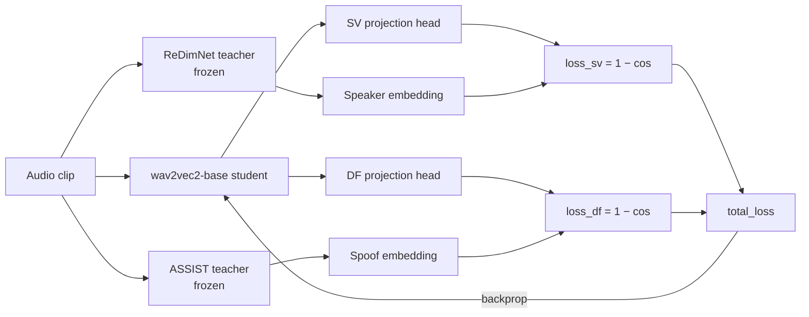

# 🏗 Architecture — Dual-Teacher Distillation with Wav2Vec2

> Part of [11-785-dual-teacher-distillation](https://github.com/shiroonigami23-ui/11-785-dual-teacher-distillation). Back to the [README](../README.md).

## 1. System Overview

Both teachers are pretrained and frozen; only the student and its heads are optimised. Each training step runs the
batch through all three networks, projects the student's pooled representation into each teacher's embedding space,
and minimises the sum of the two cosine distances.

## 2. Components

| Component | Location | Responsibility |
|---|---|---|
| **Student encoder** | `notebooks/dual_teacher_colab_v3.ipynb` | wav2vec2-base with pooling |
| **Projection heads** | `notebooks/dual_teacher_colab_v3.ipynb` | Linear heads mapping to SV and DF embedding sizes |
| **Teacher wrappers** | `notebooks/dual_teacher_colab_v3.ipynb` | Frozen ReDimNet and ASSIST inference |
| **Metrics** | `artifacts/metrics/train_meta.json` | Per-epoch losses and run metadata |
| **Pseudocode** | `docs/PSEUDOCODE.md` | Language-agnostic description of the algorithm |

## 3. Data / Control Flow

1. Load a batch of waveforms and resample to 16 kHz.
2. Compute teacher embeddings under `torch.no_grad()`.
3. Run the student; pool hidden states; apply both projection heads.
4. Compute `loss_sv`, `loss_df` and their sum; back-propagate into the student only.
5. Log losses, save `checkpoint_latest.pt` and update the loss-curve figure.

## 4. Key Design Decisions

| Decision | Rationale |
|---|---|
| Cosine distance loss | Scale-invariant and matches how SV / DF embeddings are scored downstream |
| Frozen teachers | Stable targets and lower memory use during training |
| Equal loss weights | Simple baseline before trying learned task weighting |
| Git LFS for weights | Keeps the repository lightweight to clone |

## 5. Known Limitations

- No task-level EER / minDCF numbers yet — only distillation losses
- Training code lives in a notebook rather than a package

---
*Last updated: 2026-11-13*
